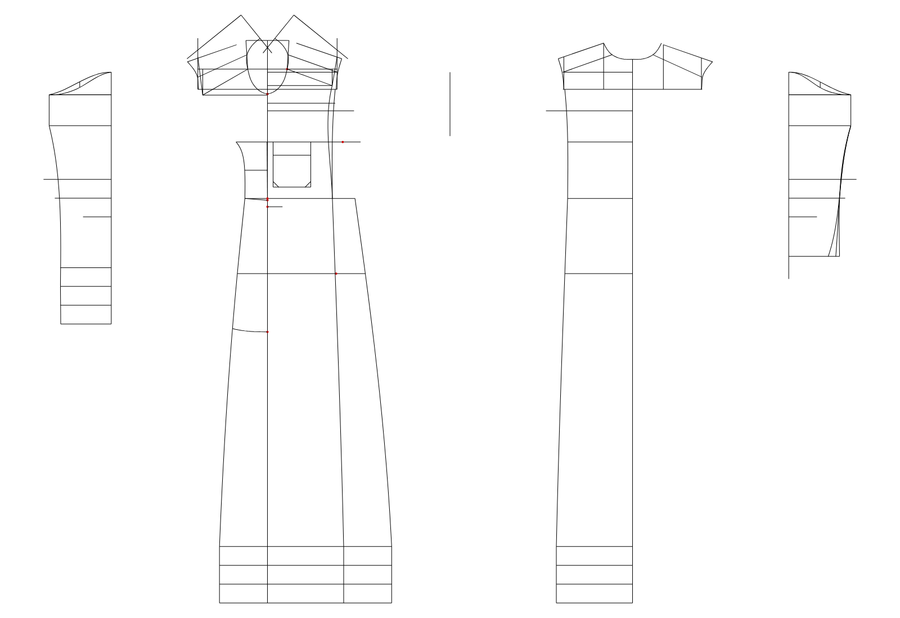

# الثوب الأساسي (basic thobe): ما تم استخراجه من ملف Grafis

المصدر: `ALAA2026.mdl`، القطعة رقم 002 «basic thobe»، والمقاس النشط `__HN40_0`.

الأداة: `python -m grafis_mdl extract samples/ALAA2026.mdl --part 2 --out out`

## الخلاصة

| البند | العدد | الحالة |
|---|---|---|
| قياسات الزبون (X) | 50 | مقروءة بالكامل، مع القيمة الافتراضية وقيمة المقاس |
| المعادلات (Z) | 89 | 75 منها محسوبة، و14 تعتمد على قيم من الرسم أو فيها خطأ |
| خطوات بروتوكول البناء | 286 | مقروءة كسجلات، وتحليل معنى كل أمر هو المرحلة الجاية |
| خطوات الماكرو (خطوط ومنحنيات) | 64 | مقروءة مع كل باراميتراتها |
| عناصر الرسم الناتجة | 187 | 142 نقطة وخط ومنحنى مرسومة، و45 عنصر مساعد لم يُفك بعد |

الرسم أعلاه مأخوذ مباشرة من إحداثيات Grafis المحفوظة في الملف (`basic-thobe.svg`، وفي ملف الإخراج DXF أيضاً).

## التحقق: معادلاتنا مقابل رسم Grafis

حسبنا المعادلات بأنفسنا من القياسات، وقارنّا النتيجة مع الرسم اللي حفظه Grafis:

| البند | المعادلة | حسابنا | رسم Grafis | الفرق |
|---|---|---|---|---|
| الطول | `Z18 = X1` | 1320.00 | 1320.00 | 0.00 |
| الكتف (نصف) | `Z9 = X3/2` | 185.00 | 185.00 | 0.00 |
| عرض فتحة الرقبة | `Z6 = X7/6.7+Z1` | 52.24 | 52.24 | 0.00 |
| طول فتحة الرقبة | `Z7 = X7/5.3+Z2` | 66.04 | 66.04 | 0.00 |
| نزول الكتف أمام R | `Z11 = X4-(X4/8)` | 43.75 | 43.75 | 0.00 |
| نزول الكتف أمام L | `Z12 = X5-1` | 69.00 | 69.00 | 0.00 |
| فرق الصدر R | `Z15 = Z9-13` | 172.00 | 172.00 | 0.00 |

كل الفروق صفر. هذا يثبت إن قراءة القياسات والمعادلات والرسم صحيحة. الاختبار نفسه موجود في `tests/test_reader.py`.

## ملاحظات مهمة لقيتها في الملف

- **Z76 «نصف الكم2» معادلتها ناقصة:** `X35/`. آخر نسخة سليمة في السجل `X35/2`. راجعها في Grafis.
- **قيم بدون معادلة:** Z23، Z24، Z28، Z29، Z52، Z53، Z54. تستخدمها معادلات ثانية (مثل Z25 وZ33 وZ35 وZ55)، ويظهر إنها تُقاس من الرسم داخل Grafis. لازم نعرف مصدرها عشان نعيد بناءها.
- **المقاس النشط `__HN40_0` يغيّر 26 قياس فقط من 50.** الباقي يستخدم القيمة الافتراضية.

## قياسات الزبون (X)

| X | الاسم | الافتراضي | قيمة __HN40_0 |
|---|---|---|---|
| X1 | — | 1500 | 1320 |
| X2 | — | 1500 | — |
| X3 | shoulder--B | 440 | 370 |
| X4 | down FRONT R | 55 | 50 |
| X5 | down FRONT L | 70 | — |
| X6 | armhole high--C2 | 440 | 340 |
| X7 | collar--E1 | 400 | 350 |
| X8 | front width 1 | 360 | — |
| X9 | chest girth | 600 | 495 |
| X10 | front width | 400 | 400 |
| X11 | back width | 460 | — |
| X12 | waist girth--D | 550 | 465 |
| X13 | hip | 600 | 520 |
| X14 | buttom girth--F1 | 750 | 660 |
| X15 | bottom width--F2 | 50 | 50 |
| X16 | down side pocket | 180 | — |
| X17 | Side pocket opening | 180 | — |
| X18 | Side pocket length--J1 | 400 | 350 |
| X19 | side pocket width | 180 | — |
| X20 | down pocket chest | 200 | — |
| X21 | Chest pocket length--H1 | 140 | 120 |
| X22 | Chest pocket width--H2 | 120 | 100 |
| X23 | jabzour--G1 | 500 | 370 |
| X24 | Jabzour Width | 40 | 40 |
| X25 | down BACK R | 50 | — |
| X26 | down BACK L | 50 | — |
| X27 | SLEEVE LENGTH | 600 | — |
| X28 | TK LENGTH--I | 160 | 150 |
| X29 | TK UP | 100 | — |
| X30 | TK DOWN | 70 | 60 |
| X31 | sleeve length sadaa--CC1 | 650 | 570 |
| X32 | sleeve length kabk--C1 | 620 | 550 |
| X33 | head down | 60 | — |
| X34 | Half sleeve size 1 | 360 | — |
| X35 | Half sleeve size--C7 | 190 | 150 |
| X36 | Half sleeve size 3 | 150 | — |
| X37 | sadaa round--CC4 | 170 | 135 |
| X38 | sadaa width--CC5 | 50 | — |
| X39 | kabk length--C4 | 140 | 105 |
| X40 | kabk width--C5 | 70 | 60 |
| X41 | collar sadaa high | 40 | — |
| X42 | gallab high front | 0 | — |
| X43 | gallab high back | 0 | — |
| X44 | collar gallab open 1 | 0 | — |
| X45 | collar gallab open 2 | 0 | — |
| X46 | collar gallab open 3 | 0 | — |
| X47 | collar gallab open 4 | 0 | — |
| X48 | high line | 0 | — |
| X49 | open hool cuff C6 | 90 | 100 |
| X50 | armhole high--C3 | 440 | — |

## المعادلات (Z)

| Z | الوصف | المعادلة | القيمة | ملاحظة |
|---|---|---|---|---|
| Z1 | — | `CMDIF[X4>50]{X4/20}{0}` | 0 |  |
| Z2 | — | `CMDIF[X4>50]{X4/24}{0}` | 0 |  |
| Z3 | — | `CMDIF[X4>=83]{0}[X4>=76]{-7}{0}` | 0 |  |
| Z4 | — | `CMDIF[X4>=76]{0}[X4>=64]{-13}{0}` | 0 |  |
| Z5 | اعلي الزراع | `X6/2` | 170 |  |
| Z6 | فتحه الرقبه عرض | `X7/6.7+Z1` | 52.24 |  |
| Z7 | فتحه الرقبه طول | `X7/5.3+Z2` | 66.04 |  |
| Z8 | فتحه الرقبه خلف | `CMDIF[X4>=64]{61}[X4<64]{50}{55}` | 50 |  |
| Z9 | الكتف | `X3/2` | 185 |  |
| Z10 | — | `CMDIF[X4>=64]{51.5}[X4<64]{48}{50}` | 48 |  |
| Z11 | نزول الكتف امام R | `X4-(X4/8)` | 43.75 |  |
| Z12 | نزول الكتف امام L | `X5-1` | 69 |  |
| Z13 | نزول الكتف خلفR | `X25` | 50 |  |
| Z14 | نزول الكتف خلفL | `X26` | 50 |  |
| Z15 | فرق الصدر R | `Z9-13` | 172 |  |
| Z16 | فرق الصدرL | `Z15` | 172 |  |
| Z17 | — | `CMDIF[X4>=83]{5}[X4>=76]{2}{0}` | 0 |  |
| Z18 | الطول | `X1` | 1320 |  |
| Z19 | بدء السفره | `Z11+10` | 53.75 |  |
| Z20 | ارتفاع السفره اتجاه الرقبه | `150+Z3+Z4+Z95` | 130 |  |
| Z21 | ارتفاع السفره اتجاه الكم | `Z20+Z17+Z96+2` | 136 |  |
| Z22 | — | `0` | 0 |  |
| Z25 | مسافه فرق امام R | `Z23` | — | تعتمد على قيمة من الرسم |
| Z26 | مسافه فرق امام L | `Z24` | — | تعتمد على قيمة من الرسم |
| Z27 | — | `0` | 0 |  |
| Z30 | مسافه الامام R | `Z28` | — | تعتمد على قيمة من الرسم |
| Z31 | مسافه الامام L | `Z29` | — | تعتمد على قيمة من الرسم |
| Z32 | — | `CMDIF[X01/9.9<51]{X28}{X01/9.9}` | 133.33 |  |
| Z33 | نزول نصف الصدر1 | `(Z5/2)+Z23` | — | تعتمد على قيمة من الرسم |
| Z34 | نزول الظهر | `Z33+20` | — | تعتمد على قيمة من الرسم |
| Z35 | نزول الصدر | `Z5+Z23+18` | — | تعتمد على قيمة من الرسم |
| Z36 | نزول الوسط | `Z35+X28` | — | تعتمد على قيمة من الرسم |
| Z37 | نزول الارداف | `Z36+200` | — | تعتمد على قيمة من الرسم |
| Z38 | كفه اسفل | `X15` | 50 |  |
| Z39 | — | `CMDIF[X14>720]{15}{0}` | 0 |  |
| Z40 | نصف الصدر1 | `X8/2` | 180 |  |
| Z41 | نصف الظهر | `X11/2` | 230 |  |
| Z42 | الصدر | `X9/2` | 247.5 |  |
| Z43 | نصف الصدر2 | `X10/2` | 200 |  |
| Z44 | الوسط | `X12/2` | 232.5 |  |
| Z45 | الارداف | `X13/2` | 260 |  |
| Z46 | اسفل | `X14/2` | 330 |  |
| Z47 | — | `CMDIF[X12/2<500]{40}[X12/2<=550]{35}{20}` | 40 |  |
| Z48 | الوسط امام | `Z44-X30` | 172.5 |  |
| Z49 | الارداف امام | `Z48+10` | 182.5 |  |
| Z50 | الجنب اسفل | `Z46-(Z48+30+Z39)` | 127.5 |  |
| Z51 | — | `0` | 0 |  |
| Z55 | اعلي التخاليص | `Z52-3` | — | تعتمد على قيمة من الرسم |
| Z56 | اسفل التخاليص | `Z53` | — | تعتمد على قيمة من الرسم |
| Z57 | اردف الجنب | `Z54` | — | تعتمد على قيمة من الرسم |
| Z58 | — | `0` | 0 |  |
| Z59 | مدي الاشتك | `1` | 1 |  |
| Z60 | ميل راس الجنب | `5` | 5 |  |
| Z61 | طول جيب الجنب | `X18` | 350 |  |
| Z62 | — | `0` | 0 |  |
| Z63 | تحريك الاكمام | `900` | 900 |  |
| Z64 | — | `0` | 0 |  |
| Z65 | طول الكم الساده | `X31` | 570 |  |
| Z66 | طول الكم الكبك | `X32` | 550 |  |
| Z67 | نزول وسع الكم اعلي | `X33` | 60 |  |
| Z68 | نزول وسع الكم 2 | `Z67+Z55` | — | تعتمد على قيمة من الرسم |
| Z69 | نزول نصف الكم1 | `Z65/2` | 285 |  |
| Z70 | نزول نصف الكم2 | `Z69+50` | 335 |  |
| Z71 | نزول نصف الكم3 | `Z70+50` | 385 |  |
| Z72 | — | `0` | 0 |  |
| Z73 | وسع الكم اعلي | `Z5-5` | 165 |  |
| Z74 | وسع الكم2 | `Z73` | 165 |  |
| Z75 | نصف الكم1 | `X34/2` | 180 |  |
| Z76 | نصف الكم2 | `X35/` | — | معادلة غير مكتملة |
| Z77 | نصف الكم3 | `X36/2` | 75 |  |
| Z78 | — | `0` | 0 |  |
| Z79 | اسفل اليد | `X37` | 135 |  |
| Z80 | كفه اليد | `X38` | 50 |  |
| Z81 | — | `0` | 0 |  |
| Z82 | كبك | `X39` | 105 |  |
| Z83 | كبك بكسره | `Z82+20` | 125 |  |
| Z84 | كبك بكسرتين | `Z83+10` | 135 |  |
| Z85 | عرض الكبك | `X40` | 60 |  |
| Z86 | — | `0` | 0 |  |
| Z87 | تصفيه الامام | `15` | 15 |  |
| Z88 | — | `0` | 0 |  |
| Z89 | — | `0` | 0 |  |
| Z90 | حركه لجيب | `15` | 15 |  |
| Z91 | طول الجيب | `X21` | 120 |  |
| Z92 | عرض الجيب | `X22` | 100 |  |
| Z93 | عرض الحشوه | `35` | 35 |  |
| Z94 | طول الجبزور من الكتف | `(X23+Z7)-70` | 366.04 |  |
| Z95 | — | `CMDIF[X4>=64]{0}[X4>=50]{-20}{0}` | -20 |  |
| Z96 | — | `CMDIF[X4>=76]{0}[X4>=50]{4}{0}` | 4 |  |

## خطوات الماكرو

من مكتبة `basis_d`: 46 × LINE 10، 18 × CURVE 10.

| الخطوة | النوع | أهم القيم |
|---|---|---|
| 2 | LINE 10 | Länge=100 |
| 3 | LINE 10 | VerschiebelinienPick-ID=3؛ Länge=100 |
| 4 | LINE 10 | Länge=100 |
| 5 | LINE 10 | Länge=100 |
| 6 | LINE 10 | Länge=100 |
| 7 | LINE 10 | Länge=100 |
| 8 | LINE 10 | Länge=100 |
| 9 | LINE 10 | Länge=100 |
| 10 | LINE 10 | Länge=5 |
| 11 | CURVE 10 | Anzahl Punkte=5؛ BP: Pick-ID Punkt=1؛ BP: Pick-ID Richtung oder 500 f.AE=2؛ BP: Schleppwinkel zur Basisrichtung=10 |
| 12 | CURVE 10 | Anzahl Punkte=3؛ BP: Pick-ID Punkt=1؛ BP: Pick-ID Punkt=3؛ BP: Pick-ID Punkt=2 |
| 13 | CURVE 10 | Anzahl Punkte=3؛ BP: Pick-ID Punkt=1؛ BP: Pick-ID Richtung oder 500 f.AE=500؛ BP: Schleppwinkel zur Basisrichtung=-19.29 |
| 14 | LINE 10 | Länge=100 |
| 15 | LINE 10 | Länge=100 |
| 16 | LINE 10 | Länge=100 |
| 17 | LINE 10 | Länge=100 |
| 18 | LINE 10 | Länge=100 |
| 19 | LINE 10 | Länge=100 |
| 20 | LINE 10 | Länge=100 |
| 21 | LINE 10 | Länge=100 |
| 22 | CURVE 10 | Anzahl Punkte=2؛ BP: Pick-ID Punkt=1؛ BP: Pick-ID Richtung oder 500 f.AE=500؛ BP: Schleppwinkel zur Basisrichtung=-4.18 |
| 23 | CURVE 10 | Anzahl Punkte=2؛ BP: Pick-ID Punkt=1؛ BP: Pick-ID Punkt=2؛ BP: Pick-ID Richtung oder 500 f.AE=500 |
| 24 | CURVE 10 | Anzahl Punkte=2؛ BP: Pick-ID Punkt=1؛ BP: Pick-ID Richtung oder 500 f.AE=500؛ BP: Schleppwinkel zur Basisrichtung=-13.58 |
| 25 | CURVE 10 | Anzahl Punkte=3؛ BP: Pick-ID Punkt=1؛ BP: Pick-ID Punkt=3؛ BP: Pick-ID Punkt=2 |
| 26 | LINE 10 | Länge=100 |
| 27 | LINE 10 | Länge=100 |
| 28 | LINE 10 | Länge=100 |
| 29 | LINE 10 | Länge=100 |
| 30 | LINE 10 | Länge=100 |
| 31 | LINE 10 | Länge=100 |
| 32 | CURVE 10 | Anzahl Punkte=3؛ BP: Pick-ID Punkt=1؛ BP: Pick-ID Richtung oder 500 f.AE=500؛ BP: Schleppwinkel zur Basisrichtung=31.96 |
| 33 | CURVE 10 | Anzahl Punkte=3؛ BP: Pick-ID Punkt=1؛ BP: Pick-ID Punkt=3؛ BP: Pick-ID Punkt=2 |
| 34 | CURVE 10 | Anzahl Punkte=2؛ BP: Pick-ID Punkt=1؛ BP: Pick-ID Richtung oder 500 f.AE=1؛ BP: Pick-ID VerschiebeLinie=1 |
| 35 | LINE 10 | Länge=54.36 |
| 36 | LINE 10 | Länge=100؛ Verschiebewert=-300؛ Verschiebewert [%]=-551.85 |
| 37 | LINE 10 | Länge=100 |
| 38 | LINE 10 | Länge=100 |
| 39 | LINE 10 | Länge=100 |
| 40 | LINE 10 | Länge=100 |
| 41 | LINE 10 | Länge=100 |
| 42 | LINE 10 | Länge=100 |
| 43 | CURVE 10 | Anzahl Punkte=2؛ BP: Pick-ID Punkt=1؛ BP: Pick-ID Richtung oder 500 f.AE=2؛ BP: Pick-ID Punkt=2 |
| 44 | LINE 10 | Länge=100 |
| 45 | CURVE 10 | Anzahl Punkte=3؛ BP: Pick-ID Punkt=1؛ BP: Pick-ID Richtung oder 500 f.AE=2؛ BP: Pick-ID Punkt=3 |
| 46 | CURVE 10 | Anzahl Punkte=2؛ BP: Pick-ID Punkt=1؛ BP: Pick-ID Richtung oder 500 f.AE=500؛ BP: Schleppwinkel zur Basisrichtung=-6.91 |
| 47 | CURVE 10 | Anzahl Punkte=2؛ BP: Pick-ID Punkt=1؛ BP: Pick-ID Richtung oder 500 f.AE=500؛ BP: Schleppwinkel zur Basisrichtung=-8.97 |
| 48 | CURVE 10 | Anzahl Punkte=2؛ BP: Pick-ID Punkt=1؛ BP: Pick-ID Richtung oder 500 f.AE=500؛ BP: Schleppwinkel zur Basisrichtung=-12.13 |
| 49 | LINE 10 | Länge=100 |
| 50 | LINE 10 | Länge=100 |
| 51 | LINE 10 | Länge=100 |
| 52 | LINE 10 | Länge=100 |
| 53 | LINE 10 | Länge=100 |
| 54 | LINE 10 | Länge=100 |
| 55 | LINE 10 | Länge=100 |
| 56 | CURVE 10 | Anzahl Punkte=2؛ BP: Pick-ID Punkt=1؛ BP: Pick-ID Richtung oder 500 f.AE=2؛ BP: Pick-ID Punkt=2 |
| 57 | LINE 10 | Länge=100 |
| 58 | CURVE 10 | Anzahl Punkte=3؛ BP: Pick-ID Punkt=1؛ BP: Pick-ID Richtung oder 500 f.AE=500؛ BP: Schleppwinkel zur Basisrichtung=-11.88 |
| 59 | CURVE 10 | Anzahl Punkte=2؛ BP: Pick-ID Punkt=1؛ BP: Pick-ID Richtung oder 500 f.AE=500؛ BP: Schleppwinkel zur Basisrichtung=9.84 |
| 60 | LINE 10 | Länge=100 |
| 61 | LINE 10 | Länge=100 |
| 62 | LINE 10 | Länge=100 |
| 63 | LINE 10 | Länge=100 |
| 64 | LINE 10 | VerschiebelinienPick-ID=3؛ Länge=100؛ Verschiebewert [%]=0 |
| 65 | LINE 10 | Länge=100 |

## بروتوكول البناء

فيه 286 سجل، وكل سجل 32 بايت. أنواع السجلات (رمز/فئة):

`101/104`×64, `103/105`×9, `104/204`×5, `104/304`×4, `104/404`×3, `105/101`×1, `117/103`×1, `119/128`×10, `196/101`×19, `197/100`×20, `203/205`×1, `203/219`×8, `205/201`×1, `206/200`×2, `219/240`×9, `294/201`×3, `296/201`×23, `297/200`×2, `297/300`×1, `303/305`×2, `303/319`×4, `319/128`×1, `319/140`×4, `394/301`×17, `396/301`×2, `397/300`×5, `403/405`×2, `403/419`×2, `419/140`×3, `419/240`×1, `494/401`×2, `496/401`×5, `503/519`×3, `519/140`×3, `594/501`×5, `603/605`×1, `619/128`×1, `619/140`×2, `703/719`×1, `719/140`×2, `719/240`×1, `803/819`×1, `819/140`×2, `903/919`×1, `919/140`×2, `1003/1019`×1, `1019/140`×3, `1103/1119`×1, `1119/140`×2, `1203/1219`×1, `1219/140`×2, `1303/1305`×1, `1319/140`×2, `1403/1419`×1, `1419/140`×2, `1503/1519`×1, `1519/140`×2, `1603/1619`×1, `1619/140`×1, `1703/1719`×1, `1719/140`×1, `1819/140`×1, `1919/140`×1

السجلات مقروءة، لكن معنى كل رمز (مثل: نقطة على مسافة، تقاطع، عمود...) لسه ما تحدد. **هذي المرحلة الجاية:** نطابق كل سجل مع العنصر اللي ينتجه في الرسم، لأن عندنا الاثنين في نفس الملف. بعدها نقدر نعيد البناء لأي مقاس ونقارن.

