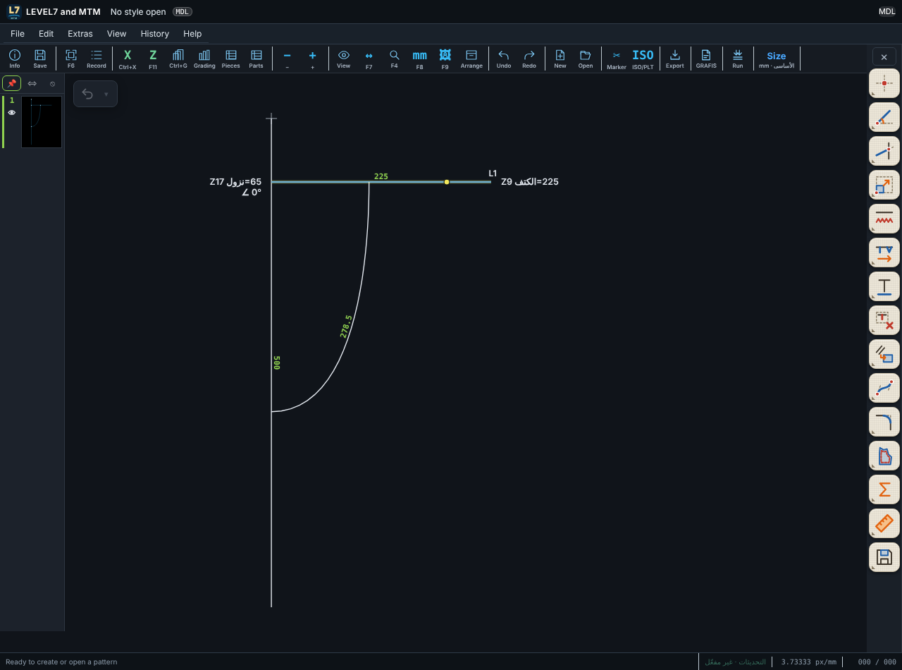

# LEVEL7 and MTM 0.9.157 — المعادلات على الرسم عند اختيار خط أو منحنى

| طلبك | التنفيذ |
|---|---|
| عند تفعيل خط أو كرف تظهر المعادلة التي بُني عليها في مكانها مثل GRAFIS | نقرة على الخط أو المنحنى (بدون أداة) تختاره وتكتب على الرسم: **عند بدايته** معادلة النقطة التي يبدأ منها، مثل `Z17 نزول=65` (كم ينزل على الخط الذي بدأ منه)، وزاوية الخط بالزاوية `∠ 0°`؛ **عند نهايته** طوله، مثل `Z9 الكتف=225`، أو معادلة النقطة التي ينتهي عليها؛ وللخط الموازي مسافته في منتصفه. الرقم الثابت يظهر وحده؛ وX أو Z يظهر معه اسمه وقيمته. |
| — | تبقى المعادلات ظاهرة أثناء تعديل الخطوة (دابل كليك). نقرة في مكان فارغ أو رايت كليك تُخفيها. |

## الاختبارات

| الاختبار | النتيجة |
|---|---|
| `tests-0.9.118/test-0157-formula-labels.mjs` | 4/4 (ومنها فحص ترتيب الكتابة: Z9 ثم الاسم ثم =225) |
| بقية اختبارات البرنامج (27 ملفاً) | 158 نجاح، 0 فشل |
| اختبارات المحرك | 69/69 |

لم يُجرَّب على ويندوز بعد.
