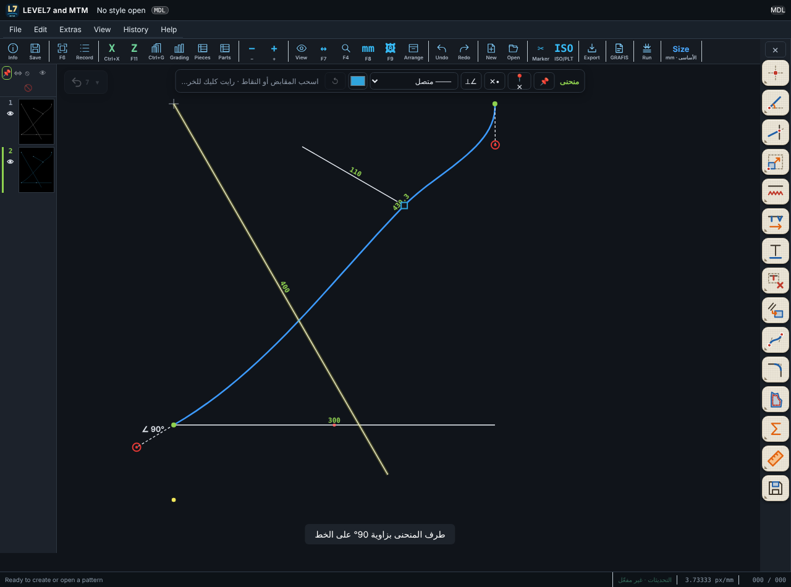
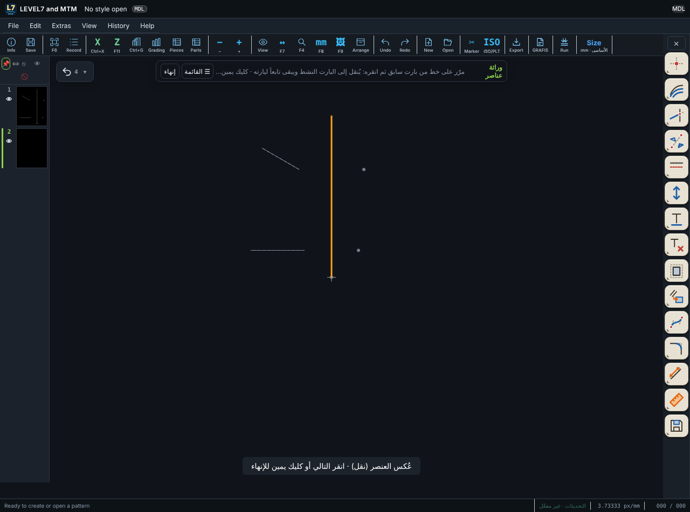
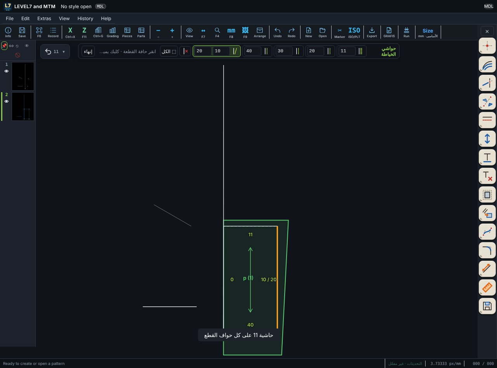

# LEVEL7 and MTM 0.9.159 — شريط المنحنى، أنواع الخطوط، الانعكاس، الوراثة بالنقر، حواشي الخياطة

| طلبك | التنفيذ |
|---|---|
| لا أريد الأرقام والحروف المعلَّمة (90° · 120%، 110 mm، L4) | لم تعد تظهر ثابتة على الرسم. زاوية المقبض ونسبته تظهران **أثناء سحبه فقط** مثل GRAFIS. طول المنحنى واسم العنصر تحت الماوس أُزيلا. |
| تثبيت نقطة على الكرف مع طرف خط أو نقطة على خط (Bind / Unbind / Delete point) | عند اختيار منحنى يظهر **شريط المنحنى** أعلى الرسم: **تثبيت نقطة**: انقر طرف خط أو نقطة أو مكاناً على خط، فيمر المنحنى به ويتبعه إذا تغيّر الخط. **فك التثبيت**: تصير النقطة حرة في مكانها. **حذف نقطة**: تُحذف من المنحنى. |
| زاوية الكرف 90° أو 45° على الخط المستقيم | زر **∠ على خط** في نفس الشريط: انقر الخط واكتب الزاوية (90 افتراضياً). تبقى الزاوية محسوبة من ذلك الخط حتى إذا دار الخط. وتظهر على الرسم مثل `∠ 90° L2`. |
| تحويل الخط إلى نقاط أو متقطع وتمييزه بلون | عند اختيار خط أو منحنى: قائمة **نوع الخط** (متصل، متقطع، نقاط، متقطع طويل، قصير-طويل، شرطة-نقطة)، و**لون** لكل خط، وزر ↺ يعيد اللون الافتراضي. |
| الانعكاس: المحور ثم نسخ/نقل ثم الخطوط واحداً واحداً، وكليك يمين للإنهاء | أدوات الانعكاس الأربع صارت كذلك: بعد المحور تختار **نسخة أو نقل**، ثم كل نقرة على عنصر تعكسه فوراً، و**كليك يمين** ينهي الأداة. |
| استخراج خطوط من بارت إلى بارت بالنقر، ويتلوّن الخط قبل النقر، ويبقى تابعاً لبارته | أداة **وراثة عناصر**: تظهر البارتات السابقة، يتلوّن **بالبرتقالي** الخط الذي تحت الماوس، والنقر ينقله إلى البارت النشط مرتبطاً ببارته (يتبعه إذا تغيّر). كليك يمين للإنهاء، وزر «القائمة» للاختيار من القائمة القديمة. |
| مسافات الخياطة مثل GRAFIS | أداة جديدة **حواشي الخياطة** في مجموعة القطع، وشريطها فيه: **قياسي** (وزر «الكل»)، **مسافة** بثلاث قيم (20، 30، 40)، **غير متوازية** بقيمتين (الأولى عند طرف الحد الأقرب للنقرة)، و**بدون**. تنقر حواف القطعة فتظهر قيمة كل حافة عليها، مثل `10 / 20`. وفي صفحة القطع عمود جديد «عند النهاية» للحاشية غير المتوازية. |
| بارت الكتف يختفي | كان كل بارت جديد مخفياً حتى تضغط عينه. الآن **كل البارتات ظاهرة** إلا ما تخفيه، وتُرسم بخط متصل باهت قليلاً خلف البارت النشط. وفي شريط البارتات زرّان: **👁 إظهار الكل** و**🚫 إخفاء الكل**. |

أيضاً: الحقل الذي تنقره يُحدَّد كله فيُستبدل بما تكتبه، حتى مع الكتابة السريعة. كان أحياناً يُدرج الرقم داخل القيمة القديمة.

## الاختبارات

| الاختبار | النتيجة |
|---|---|
| `tests-0.9.118/test-0159-curve-bar.mjs` | 8/8 |
| `tests-0.9.118/test-0160-mirror-inherit-seam.mjs` | 4/4 |
| اختبارات المحرك (ومنها `seam.test.ts` الجديد للحاشية غير المتوازية) | 72/72 |
| بقية اختبارات البرنامج | REGRESSION |

لم يُجرَّب على ويندوز بعد.
