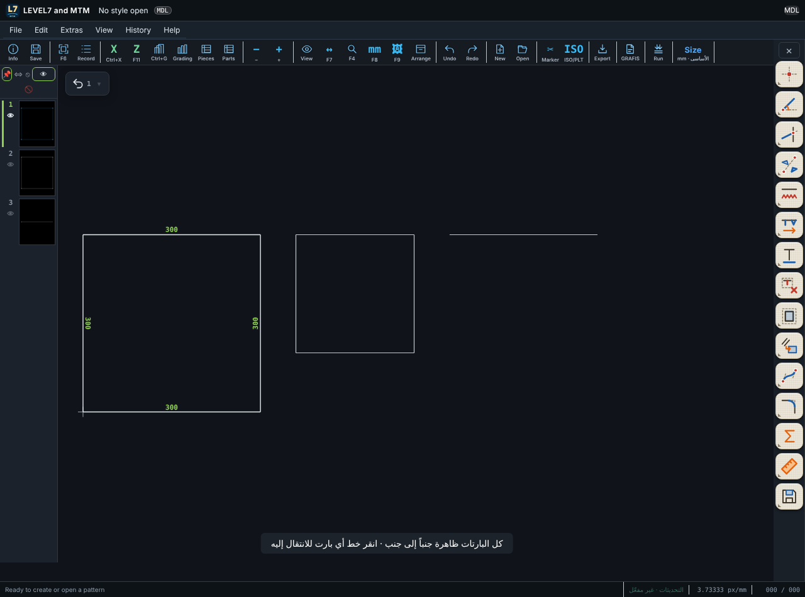

# LEVEL7 and MTM 0.9.162 — إظهار كل البارتات مثل GRAFIS

| طلبك | التنفيذ |
|---|---|
| عند الضغط على إظهار كل البارتات يظهر مثل GRAFIS | زر **👁 إظهار الكل** في شريط البارتات يرسم **كل البارتات جنباً إلى جنب** في صفوف، بترتيب أرقامها، بخط متصل، **لا فوق بعضها**. البارت النشط بألوانه، والبارت الذي تمر عليه بالماوس **يتلوّن بالأزرق**، و**النقر عليه ينقلك إليه** وهو في مكانه على الشاشة. زر **🚫** يعيد البارت النشط وحده. وعين البارت الواحد 👁 ما زالت تُظهره باهتاً في مكانه خلف البارت النشط (للتتبع والنقل). |

## الاختبارات

| الاختبار | النتيجة |
|---|---|
| `tests-0.9.118/test-0162-show-all-parts.mjs` | 3/3 |
| بقية اختبارات البرنامج | REGRESSION |
| اختبارات المحرك | 72/72 |

لم يُجرَّب على ويندوز بعد.
