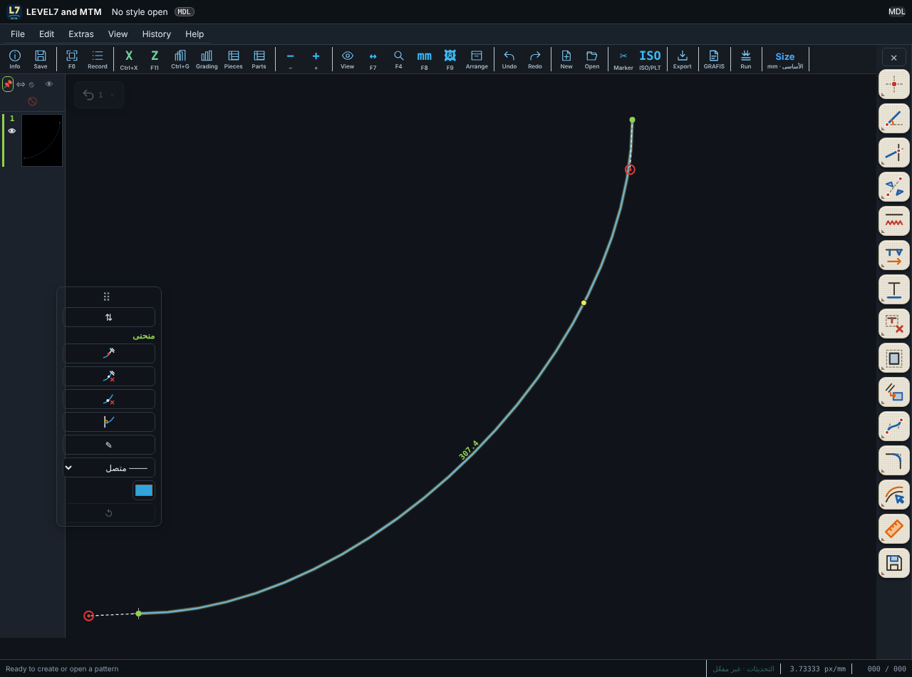

# LEVEL7 and MTM 0.9.167 — تحريك الشريط وقلبه، وتحريك خطوط القياس

| طلبك | التنفيذ |
|---|---|
| تحريك شريط الكرف إلى أي مكان في الشاشة، وترتيب أيقوناته أفقي أو رأسي | في أول الشريط **مقبض ⠿**: اسحبه إلى أي مكان في الرسم فيبقى هناك، و**دابل كليك** عليه يعيده إلى مكانه. **زر ⇅** يقلب الأيقونات بين **أفقي ورأسي**. يحفظ البرنامج المكان والاتجاه، والمقبض والزر نفساهما في شريطي الحواشي والوراثة. |
| عند محاولة تحريك خط القياس يذهب التحديد إلى خط الرسم لا إلى خط القياس الأخضر | كانت علامة الاقتراب تُضيء خط الرسم الأقرب حتى والماوس على البعد. الآن، بدون أداة مفتوحة، **البعد الذي تحت الماوس هو الذي يتوهّج** ويتغيّر شكل المؤشر إلى علامة التحريك، والضغط والسحب يحرّك البعد. منطقة التقاطه صارت أوسع قليلاً (10 بكسل). |

## الاختبارات

| الاختبار | النتيجة |
|---|---|
| `tests-0.9.118/test-0167-bar-move.mjs` | 4/4 |
| `tests-0.9.118/test-0168-dim-hover.mjs` | 2/2 |
| بقية اختبارات البرنامج (36 ملفاً) | نجحت كلها، 197 نجاح (اختبار 0118-x-length ينجح ثم ينتظر xvfb-run حتى المهلة، وهي مشكلة قديمة في بيئة الاختبار) |
| اختبارات المحرك | 74/74 |

لم يُجرَّب على ويندوز بعد.
